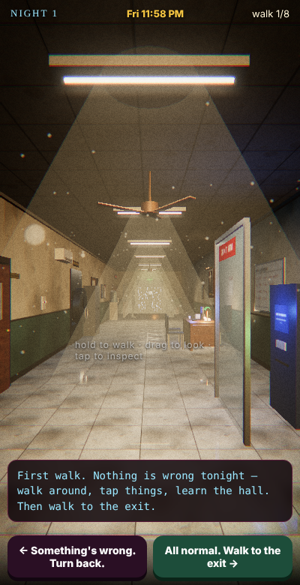
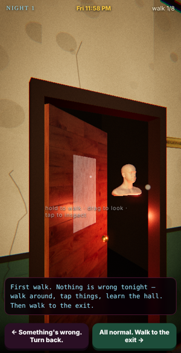
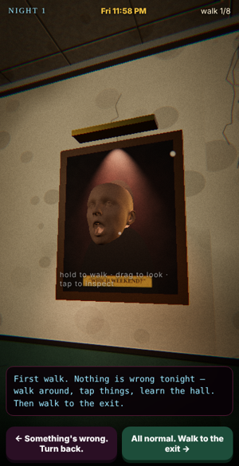
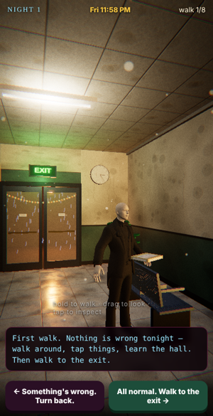
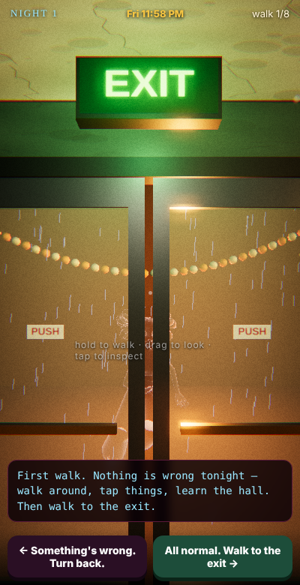

# 👹 Goku's Wedding Dash: Weekend Nightmare

A slow, first-person horror-comedy browser game about a bank manager, a
wedding on Sunday, and a phone that does not know what a weekend is.

**Play: https://goku-wedding-dash.fly.dev** — headphones on, lights off.

<p align="center">    </p>

## How it plays

It's an *anomaly hunt* (think *Exit 8*, *Escape Work*), in a real 3D bank
hall. Hold to walk, drag to look, tap anything to read its story. You walk
the same hall from Friday night to Sunday's muhurtha.

- **Normal night** → walk to the EXIT at the far end.
- **Anything wrong** → walk back to the STAFF ONLY door behind you.
- Eight right calls → the mantapa. One wrong call → Friday, 11:58 PM, again.

Story cards between walks introduce the Manager, the customers, and the three
who got away. **Roast mode** lets your group type their own names on their
own phones; those names never leave the device.

## What's in the hall

Regional Manager's cabin (keep the door closed), strong room, three counters
with the shutters down, NOW SERVING display, Goku's desk under the Chairman,
the waiting bench nobody leaves, ATM lobby, security desk with CCTV, ceiling
fans, a money plant, rain outside the exit — and 25 things that can go wrong.

Rendering: three.js, PBR materials with procedurally generated textures,
HDR environment, bloom, film grain, lens dirt, volumetric light cones, mirror
floor and shadows in Cinematic mode. Characters: a photogrammetry head scan,
an animated talking face, a Mixamo figure with a ghost shader. All audio is
synthesized in the browser (reverb, rain, hum, footsteps, whispers).

## Run locally

```sh
node server.js        # http://localhost:8080  (leaderboard → scores.json)
```
Needs a server (ES modules) — `file://` won't work.

Debug helpers: `?anom=cabin_eyes` forces an anomaly on every walk,
`?pos=x,z,yaw,pitch` starts the camera somewhere specific.

## Deploy (Fly.io)

Pushes to `main` auto-deploy via GitHub Actions (`FLY_API_TOKEN` secret).
The leaderboard lives on a 1 GB Fly volume named `data`.

## Contributing

PRs welcome — see [CONTRIBUTING.md](CONTRIBUTING.md). The easiest, most fun
contribution is **a new anomaly**: one line of story in `js/story.js`, one
scene effect in `js/scene.js`. Keep it creepy-funny, keep it PG, no real
people.

## Credits & licenses

- Code: MIT.
- [three.js](https://threejs.org) (MIT) and textures/models from its examples.
- Head scan "Infinite" by [Lee Perry-Smith](http://www.ir-ltd.net/) — CC BY 3.0.
- Face capture model from the three.js examples (Face Cap demo).
- Michelle / X Bot characters: Adobe Mixamo.
- HDRI: Poly Haven (CC0) via three.js examples.
